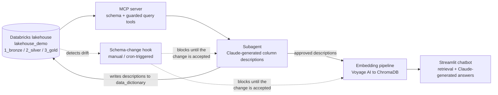

# Medallion Architecture Data Dictionary RAG

An AI + Analytics Engineering integration project: a RAG chatbot that auto-generates and answers questions about a data dictionary over a Databricks Medallion (Bronze/Silver/Gold) lakehouse. A Claude-powered subagent inspects table/column metadata via a custom MCP server and drafts human-readable descriptions. Once a person approves them, they're embedded with Voyage AI into ChromaDB and served through a Streamlit chatbot that retrieves relevant entries and answers in natural language via the Anthropic API.

## Problem

A medallion lakehouse stores the same business concept several times: `c_mktsegment` in bronze, `market_segment` in silver, and `market_segment` again in a gold aggregate. The schema doesn't say what a column means, which layer to use, or where it came from, so analysts ask a colleague or read the transformation code. Hand-written dictionaries take effort and go stale when the schema changes.

Generating the dictionary with an LLM removes the effort but adds a new risk: the model states plausible details the data doesn't show. In this project, 74 of the 80 generated descriptions were corrected during review. So generation is only the first step: drafts need a person's approval before they're published, schema changes stop re-indexing until someone reviews them, and answers are measured against a fixed question set.

## Results

Measured on 2026-11-06 with [`medallion-eval`](src/medallion_rag/evaluation/run_eval.py). The [questions](eval/questions.json), [raw results and answers](eval/results.json), and [answer grades](eval/answer_grades.json) are all in the repo.

**Source data.** The lakehouse is built from the public `samples.tpch` tables `customer`, `orders` and `lineitem`, with order dates from 1992-01-01 to 1998-08-02.

| Layer | Tables | Columns | Rows |
|---|---|---:|---:|
| Bronze | `raw_customers`, `raw_orders`, `raw_lineitem` | 39 | 38,249,795 |
| Silver | `customers`, `orders`, `order_items` | 27 | 38,249,795 |
| Gold | `daily_sales_summary`, `customer_ltv` | 14 | 502,395 |

**Retrieval accuracy.** 26 of the 32 questions have an expected column. The other 6 ask about things the dictionary doesn't contain, so they're only scored on the answer.

| Question type | Questions | Expected column ranked first | Expected column in top 5 |
|---|---:|---:|---:|
| One concept | 16 | 14 | 16 |
| Same concept in two places (all must be in the top 5) | 5 | 4 | 5 |
| Lineage | 5 | 4 | 5 |
| **Total** | **26** | **22 (85%)** | **26 (100%)** |

**Answer quality.** All 32 answers met their written criterion, including the 5 lineage questions and the 6 questions the dictionary can't answer. However, **4 of the 32 answers also added a detail the dictionary doesn't support**, down from 10 before the chatbot's prompt was tightened to state only what the retrieved entries say. For example, one answer says `customers.phone` was validated, which the dictionary doesn't say, and another calls a gold column silver. This is a known limitation, so a reader should check any answer's sources, which the chatbot shows below each reply.

**Time and cost**

| Measure | Result |
|---|---|
| Description generation | 122.7 s for 80 columns (1.53 s per column) |
| Generation cost | $0.054 in total, $0.00067 per column (470 input and 41 output tokens on average) |
| Full index build | 8.0 s, $0.00016 (2,595 Voyage tokens) |
| Index re-run with nothing changed | 4.4 s, no embedding cost |
| Median answer latency | 1.86 s (slowest 2.69 s) |
| Cost per question | $0.0012 (692 input, 103 output and 9 Voyage tokens on average) |

**How to read these numbers**

- The question set is small, and its author had read the descriptions first, so scores may run high. It's a regression check, not an estimate of accuracy on new questions.
- The stricter prompt was written after seeing the earlier errors on these same questions, and both figures come from one run each, so the drop from 10 to 4 may overstate the improvement on new questions. The earlier count would be 11 by the standard used for this run, because one wording that's now counted wasn't counted then. Three of the 4 also appeared in the earlier run, and one is a new error.
- Answers were graded by Claude Code, the AI assistant that ran the evaluation. The project owner approved the questions and criteria beforehand, but hasn't independently graded the answers.
- Costs use list prices on the measurement date: Claude Haiku 4.5 at $1 per million input tokens and $5 per million output tokens, and Voyage `voyage-3.5` at $0.06 per million tokens. Any free allowance isn't counted.
- Generation time covers model calls and sample reads, but not the database write for each row. It also includes about 30 seconds of retries after failed Databricks DNS lookups at the start of this run, estimated from the retry log. Row counts come from an earlier check of the tables, not this run.
- Latency comes from one run on one laptop, with calls spaced 21 seconds apart. On Voyage's free tier of 3 requests a minute, a burst of questions can wait up to about a minute. The chatbot's own rendering time isn't included.

To reproduce these numbers, run `venv/bin/medallion-eval`. It takes about 15 minutes and costs about $0.09. It doesn't change the lakehouse or the local index, but it does overwrite `eval/results.json`, and the answers then need grading again.

Decisions and limits are written up in the [design doc](docs/design.md) and the ADRs on [ChromaDB vs Databricks Vector Search](docs/adr/0001-chromadb-vs-databricks-vector-search.md), the [banned-phrase filter](docs/adr/0002-banned-phrase-filter-vs-prompt-only.md), and the [schema-change hook](docs/adr/0003-manual-schema-hook-vs-auto-rebuild.md).

## Architecture




All code lives under [`src/medallion_rag/`](src/medallion_rag):

- [`mcp_server/`](src/medallion_rag/mcp_server) — MCP server exposing schema inspection and LIMIT-guarded query tools over the lakehouse.
- [`subagents/`](src/medallion_rag/subagents) — Reads table/column metadata via MCP, drafts descriptions with Claude, writes them back to `data_dictionary`, and publishes approved ones as Unity Catalog column comments with their lineage.
- [`embeddings/`](src/medallion_rag/embeddings) — Embeds approved dictionary entries with Voyage AI and indexes them in ChromaDB.
- [`chatbot/`](src/medallion_rag/chatbot) — Streamlit chat UI; retrieves from ChromaDB and answers via the Anthropic API.
- [`hooks/`](src/medallion_rag/hooks) — Schema drift check that blocks dictionary updates and re-indexing until a change is reviewed.
- [`evaluation/`](src/medallion_rag/evaluation) — Measures retrieval accuracy, latency, build time and cost against the fixed questions in [`eval/`](eval).

## Key engineering decisions

- **Layer-aware description generation.** Bronze columns are described as raw, as-ingested data — the prompt explicitly forbids asserting uniqueness, primary-key status, or clean joinability that hasn't been established yet at that layer. Silver/Gold columns get relational language (primary key, join key, etc.) once the data has actually been conformed. ([`subagents/generate_descriptions.py`](src/medallion_rag/subagents/generate_descriptions.py#L88-L98))

- **Programmatic guardrail against LLM fabrication.** Prompt wording alone didn't stop the model from inventing plausible-sounding but unevidenced claims — e.g. calling a plain bronze STRING column "encoded" or "hashed" with no such pattern in the sample values. A banned-phrase filter catches this on bronze string columns and triggers one corrective retry with the offending phrase named explicitly. If the retry also fails, nothing is stored: the column stays pending and the run reports a failure. ([`subagents/generate_descriptions.py`](src/medallion_rag/subagents/generate_descriptions.py#L166-L277))

- **Retrieval-aware answer logic, not "newest layer wins."** When the top two ChromaDB matches are near-tied, the chatbot distinguishes *why* they're tied before deciding how to answer: raw-vs-cleaned pairs (bronze/silver) get a "here's both, but use the cleaned one" answer, while a general column tied with a purpose-built Gold aggregate gets "here's both, scoped differently — you decide," since a Gold aggregate isn't simply a more-refined version of the same thing. ([`chatbot/app.py`](src/medallion_rag/chatbot/app.py#L93-L148))

## Setup

**Prerequisites**
- A Databricks workspace with the public `samples.tpch` catalog (this project uses Databricks Free Edition)
- An [Anthropic API key](https://console.anthropic.com/)
- A [Voyage AI API key](https://www.voyageai.com/)

**Build the lakehouse**

Open [`sql/build_lakehouse.sql`](sql/build_lakehouse.sql) in the Databricks SQL editor and run the whole file, once. It creates `lakehouse_demo` from `samples.tpch`, copying about 38 million rows; the notebooks it was translated from took about 80 seconds. It replaces any existing tables of the same name.

The file was checked against the live tables with `EXPLAIN` and `DESCRIBE QUERY`, and every table's columns and types match. It hasn't been run from start to finish, because that would replace those tables.

**Run**

```bash
cp .env.example .env              # fill in DATABRICKS_*, ANTHROPIC_API_KEY, VOYAGE_API_KEY
make refresh                      # create venv/, install, and draft the descriptions
venv/bin/medallion-approve        # list the drafts
venv/bin/medallion-approve --all  # after reviewing them (or name specific columns)
make up                           # index approved descriptions and launch the chatbot
```

The chatbot only answers from approved descriptions, so it has nothing to answer from until the approval step is done.

**Refresh after the lakehouse changes**

```bash
make refresh
```

This can run on a schedule (e.g. cron). It checks for schema drift, adds or removes dictionary rows, describes new columns, and embeds only new or changed approved rows. It stops at the first failure.

If the schema changed, `make refresh` exits 1 and logs the changes. After reviewing them, record the new baseline and run it again:

```bash
venv/bin/medallion-schema-drift --accept
make refresh
```

**Approve descriptions**

Generated descriptions stay drafts until someone reviews them. Only approved ones reach the chatbot's index and are published as Unity Catalog column comments, each followed by the upstream columns from `system.access.column_lineage`:

```bash
venv/bin/medallion-approve                    # list descriptions awaiting approval
venv/bin/medallion-approve orders.clerk       # approve specific columns (or --all)
venv/bin/medallion-comments --dry-run         # preview the comments
venv/bin/medallion-comments                   # publish them (make refresh also does this)
venv/bin/medallion-index                      # add them to the chatbot's index (so does make refresh)
```

**Run a single step**

With `venv` activated, from the repo root: `medallion-schema-drift`, `medallion-describe [--dry-run]`, `medallion-index`, `medallion-chat` or `medallion-eval`.

If you create your own environment in an iCloud-synced folder on macOS, name it `venv`, not `.venv`. iCloud flags dot-folders as hidden, and recent Python versions skip hidden `.pth` files, which breaks the editable install.

## Development

Tests use mocked clients, so they need no credentials. CI runs both commands on every pull request.

```bash
pip install -e ".[dev]"
ruff check .
pytest
```

## Demo

https://github.com/user-attachments/assets/a20f744e-d26a-4bd6-8e98-ba34087eae53

## Tech stack

Python · Databricks SQL · MCP (Model Context Protocol) · Anthropic API · Voyage AI · ChromaDB · Streamlit

## Possible extensions

- Multi-turn conversational memory in the chatbot (currently each question is answered independently of prior turns' retrieval).
