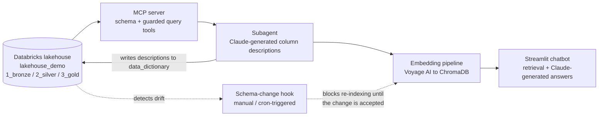
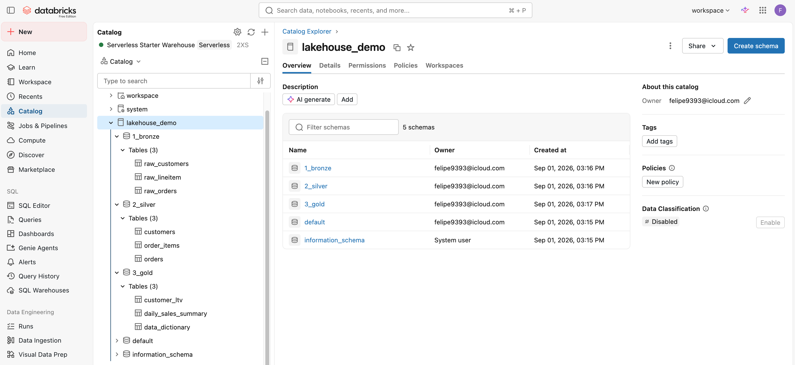
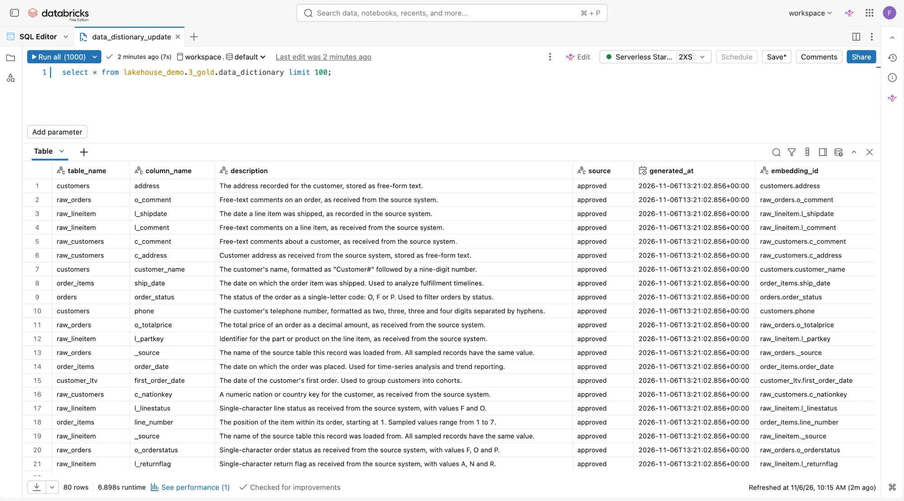

# Medallion Architecture Data Dictionary RAG

An AI + Analytics Engineering integration project: a RAG chatbot that auto-generates and answers questions about a data dictionary over a Databricks Medallion (Bronze/Silver/Gold) lakehouse. A Claude-powered subagent inspects table/column metadata via a custom MCP server and drafts human-readable descriptions, which are embedded with Voyage AI into ChromaDB and served through a Streamlit chatbot that retrieves relevant entries and answers in natural language via the Anthropic API.

## Architecture







All code lives under [`src/medallion_rag/`](src/medallion_rag):

- [`mcp_server/`](src/medallion_rag/mcp_server) — MCP server exposing schema inspection and LIMIT-guarded query tools over the lakehouse.
- [`subagents/`](src/medallion_rag/subagents) — Reads table/column metadata via MCP, drafts descriptions with Claude, writes them back to `data_dictionary`, and publishes approved ones as Unity Catalog column comments with their lineage.
- [`embeddings/`](src/medallion_rag/embeddings) — Embeds dictionary entries with Voyage AI and indexes them in ChromaDB.
- [`chatbot/`](src/medallion_rag/chatbot) — Streamlit chat UI; retrieves from ChromaDB and answers via the Anthropic API.
- [`hooks/`](src/medallion_rag/hooks) — Schema drift check that blocks re-indexing until a change is reviewed.

## Key engineering decisions

- **Layer-aware description generation.** Bronze columns are described as raw, as-ingested data — the prompt explicitly forbids asserting uniqueness, primary-key status, or clean joinability that hasn't been established yet at that layer. Silver/Gold columns get relational language (primary key, join key, etc.) once the data has actually been conformed. ([`subagents/generate_descriptions.py`](src/medallion_rag/subagents/generate_descriptions.py#L87-L97))

- **Programmatic guardrail against LLM fabrication.** Prompt wording alone didn't stop the model from inventing plausible-sounding but unevidenced claims — e.g. calling a plain bronze STRING column "encoded" or "hashed" with no such pattern in the sample values. A banned-phrase filter catches this on bronze string columns and triggers one corrective retry with the offending phrase named explicitly. If the retry also fails, nothing is stored: the column stays pending and the run reports a failure. ([`subagents/generate_descriptions.py`](src/medallion_rag/subagents/generate_descriptions.py#L165-L276))

- **Retrieval-aware answer logic, not "newest layer wins."** When the top two ChromaDB matches are near-tied, the chatbot distinguishes *why* they're tied before deciding how to answer: raw-vs-cleaned pairs (bronze/silver) get a "here's both, but use the cleaned one" answer, while a general column tied with a purpose-built Gold aggregate gets "here's both, scoped differently — you decide," since a Gold aggregate isn't simply a more-refined version of the same thing. ([`chatbot/app.py`](src/medallion_rag/chatbot/app.py#L83-L138))

## Setup

**Prerequisites**
- A Databricks workspace with the public `samples.tpch` catalog (this project uses Databricks Free Edition)
- An [Anthropic API key](https://console.anthropic.com/)
- A [Voyage AI API key](https://www.voyageai.com/)

**Build the lakehouse**

Open [`sql/build_lakehouse.sql`](sql/build_lakehouse.sql) in the Databricks SQL editor and run the whole file, once. It creates `lakehouse_demo` from `samples.tpch`, copying about 38 million rows; the notebooks it was translated from took about 80 seconds. It replaces any existing tables of the same name.

The file was checked against the live tables with `EXPLAIN` and `DESCRIBE QUERY`, and every table's columns and types match. It hasn't been run from start to finish, because that would replace those tables.

**Run**

```bash
cp .env.example .env   # fill in DATABRICKS_*, ANTHROPIC_API_KEY, VOYAGE_API_KEY
make up
```

`make up` creates `venv/`, installs the project, builds the dictionary and index, and launches the chatbot.

**Refresh after the lakehouse changes**

```bash
make refresh
```

This can run on a schedule (e.g. cron). It checks for schema drift, adds or removes dictionary rows, describes new columns, and embeds only new or changed rows. It stops at the first failure.

If the schema changed, `make refresh` exits 1 and logs the changes. After reviewing them, record the new baseline and run it again:

```bash
venv/bin/medallion-schema-drift --accept
make refresh
```

**Approve descriptions**

Generated descriptions stay drafts until someone reviews them. Only approved ones are published as Unity Catalog column comments, each followed by the upstream columns from `system.access.column_lineage`:

```bash
venv/bin/medallion-approve                    # list descriptions awaiting approval
venv/bin/medallion-approve orders.clerk       # approve specific columns (or --all)
venv/bin/medallion-comments --dry-run         # preview the comments
venv/bin/medallion-comments                   # publish them (make refresh also does this)
```

**Run a single step**

With `venv` activated, from the repo root: `medallion-schema-drift`, `medallion-describe [--dry-run]`, `medallion-index` or `medallion-chat`.

If you create your own environment in an iCloud-synced folder on macOS, name it `venv`, not `.venv`. iCloud flags dot-folders as hidden, and recent Python versions skip hidden `.pth` files, which breaks the editable install.

## Development

Tests use mocked clients, so they need no credentials. CI runs both commands on every pull request.

```bash
pip install -e ".[dev]"
ruff check .
pytest
```

## Demo

https://github.com/user-attachments/assets/a20f744e-d26a-4bd6-8e98-ba34087eae53

## Tech stack

Python · Databricks SQL · MCP (Model Context Protocol) · Anthropic API · Voyage AI · ChromaDB · Streamlit

## Possible extensions

- Multi-turn conversational memory in the chatbot (currently each question is answered independently of prior turns' retrieval).
