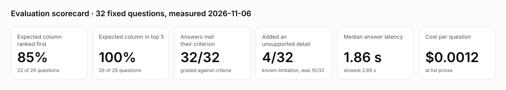
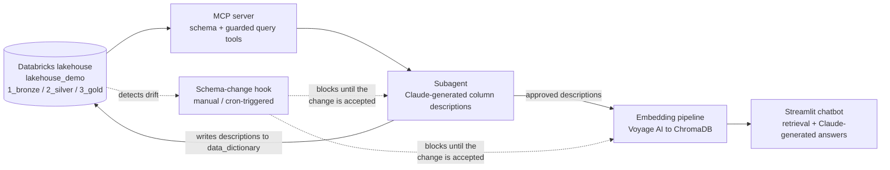
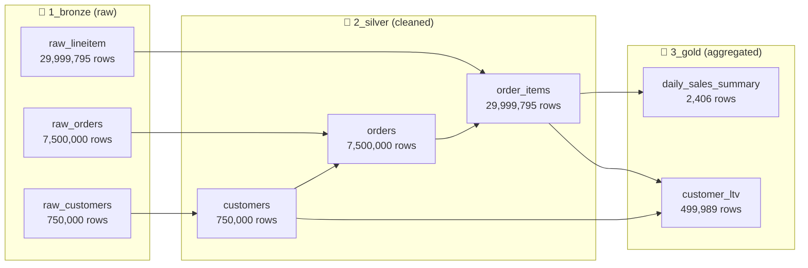
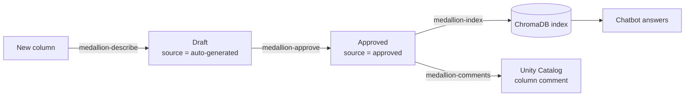
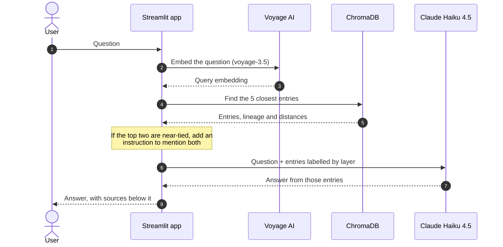
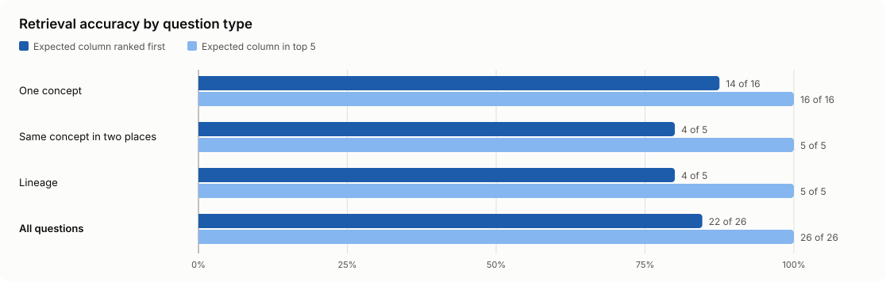
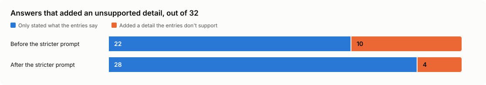

<div align="center">

# 🔍 Medallion Architecture Data Dictionary RAG

**Ask a Databricks lakehouse what a column means, which layer to use, and where the data came from.
Claude drafts the dictionary, a person approves it, and a chatbot answers only from what was approved.**

[](https://github.com/felipecastro-data/medallion-data-dictionary-rag-system/actions/workflows/ci.yml)


[](LICENSE)

[Why](#-why-this-project) · [Architecture](#-architecture) · [Features](#-features) · [Demo](#-see-it-run) ·
[Results](#-results) · [Decisions](#-architecture-decisions) · [Quickstart](#-quickstart) · [Author](#-author--certifications)



</div>

---

## 💡 Why this project

A medallion lakehouse stores the same business concept several times: `c_mktsegment` in bronze, `market_segment` in silver, and `market_segment` again in a gold aggregate. The schema doesn't say what a column means, which layer to use, or where it came from, so analysts ask a colleague or read the transformation code. Hand-written dictionaries take effort and go stale when the schema changes.

Generating the dictionary with an LLM removes the effort but adds a new risk: the model states plausible details the data doesn't show. In this project, 74 of the 80 generated descriptions were corrected during review. So generation is only the first step:

| | Step | What happens |
|---|---|---|
| ✍️ | **Draft** | `medallion-describe` reads each column's schema and sample rows, and Claude writes a description for its layer. A banned-phrase filter rejects unsupported claims on bronze string columns. |
| ✅ | **Approve** | Every description stays a draft until a person runs `medallion-approve`. |
| 🗂️ | **Index** | `medallion-index` embeds approved descriptions and their lineage with Voyage AI into ChromaDB, and only re-embeds what changed. |
| 💬 | **Answer** | The chatbot retrieves the 5 closest entries, and Claude answers from those entries, with the sources shown below each reply. |
| 🚧 | **Guard** | A schema-drift check stops describing and indexing until someone accepts the change. |
| 📏 | **Measure** | `medallion-eval` scores retrieval, answers, latency and cost against a fixed question set. |

---

## 🧱 Architecture



The subagent calls the MCP server's guarded functions directly in Python. Any MCP client can use the same tools over the protocol.

### The lakehouse

Built from the public `samples.tpch` tables by [`sql/build_lakehouse.sql`](sql/build_lakehouse.sql):



### How a description reaches the chatbot



### How a question is answered



### Code

All code lives under [`src/medallion_rag/`](src/medallion_rag):

| Package | What it does |
|---|---|
| [`mcp_server/`](src/medallion_rag/mcp_server) | MCP server exposing schema inspection and LIMIT-guarded query tools over the lakehouse. |
| [`subagents/`](src/medallion_rag/subagents) | Reads table and column metadata through the MCP server's tools, drafts descriptions with Claude, writes them back to `data_dictionary`, and publishes approved ones as Unity Catalog column comments with their lineage. |
| [`embeddings/`](src/medallion_rag/embeddings) | Embeds approved dictionary entries with Voyage AI and indexes them in ChromaDB. |
| [`chatbot/`](src/medallion_rag/chatbot) | Streamlit chat UI: retrieves from ChromaDB and answers through the Anthropic API. |
| [`hooks/`](src/medallion_rag/hooks) | Schema drift check that blocks dictionary updates and re-indexing until a change is reviewed. |
| [`evaluation/`](src/medallion_rag/evaluation) | Measures retrieval accuracy, latency, build time and cost against the fixed questions in [`eval/`](eval). |

---

## ✨ Features

### 🥉 Layer-aware description generation

Bronze columns are described as raw, as-ingested data. The prompt explicitly forbids asserting uniqueness, primary-key status, or clean joinability that hasn't been established yet at that layer. Silver and gold columns get relational language (primary key, join key) once the data has actually been conformed. ([`subagents/generate_descriptions.py`](src/medallion_rag/subagents/generate_descriptions.py#L88-L98))

### 🛡️ Programmatic guardrail against LLM fabrication

Prompt wording alone didn't stop the model from inventing plausible-sounding but unevidenced claims, such as calling a plain bronze STRING column "encoded" or "hashed" with no such pattern in the sample values. A banned-phrase filter catches this on bronze string columns and triggers one corrective retry with the offending phrase named explicitly. If the retry also fails, nothing is stored: the column stays pending and the run reports a failure. ([`subagents/generate_descriptions.py`](src/medallion_rag/subagents/generate_descriptions.py#L166-L277))

### ✅ Approval before anything reaches a reader

Only rows with `source = approved` are indexed or published as column comments. If no rows are approved, `medallion-index` logs a warning and leaves the index unchanged, so a bad read can't wipe it. Review matters, as these corrections show:

| Column | First draft said | The dictionary now says | Why it changed |
|---|---|---|---|
| `orders.order_status` | "O for Open, F for Fulfilled, and P for Pending" | "a single-letter code: O, F or P" | The data lists the codes but doesn't define them. |
| `orders.market_segment` | "Categorizes each order into a market segment" | "Copied from the customer record, so it describes the customer, not the order" | Lineage shows it comes from the customer. |
| `customer_ltv.customer_id` | "in the e-commerce business" | "The table has exactly one row per customer" | Nothing shows an e-commerce business, and the row count can be checked. |

### 🧭 Retrieval-aware answers, not "newest layer wins"

When the top two ChromaDB matches are near-tied, the chatbot distinguishes *why* they're tied before deciding how to answer. Raw-vs-cleaned pairs (bronze and silver) get a "here's both, but use the cleaned one" answer. A general column tied with a purpose-built gold aggregate gets "here's both, scoped differently, you decide", since a gold aggregate isn't simply a more refined version of the same thing. ([`chatbot/app.py`](src/medallion_rag/chatbot/app.py#L93-L148))

### 🔌 MCP tools with guarded queries

| Tool | What it returns | Guard |
|---|---|---|
| `list_tables` | Table names in a lakehouse schema | Allowlisted schemas |
| `get_schema` | Column names, data types and nullability | Allowlisted tables |
| `get_sample_rows` | A small sample of rows | Allowlisted tables, at most 50 rows |
| `get_column_lineage` | The upstream columns each column is derived from | Allowlisted tables |
| `search_metadata` | Dictionary rows matching a search term, with their `source` | Searches `data_dictionary` only |

### 🚧 Schema changes stop the pipeline

`make refresh` checks the schema first. If it changed, the run exits 1 and logs the changes, and nothing is described or re-indexed until someone reviews them and runs `medallion-schema-drift --accept`. Changes are reported rather than applied automatically, because a person should decide what a new or changed column means.

---

## 🎬 See it run

https://github.com/user-attachments/assets/a20f744e-d26a-4bd6-8e98-ba34087eae53

*Recorded in September 2026, before the description corrections and the stricter prompt, so its answers differ from the results below.*

**Real answers from the evaluation run** ([all 32](eval/results.json)). These two show the intended behaviour, and 4 other answers added an unsupported detail, as [Results](#-results) explains.

> **What does order status P mean?**
>
> The data dictionary doesn't define what the letter codes mean. It only tells you that order status can be one of three values: F, O, or P. [...] But the dictionary itself doesn't say what P stands for — it just lists P as one of the valid values alongside F and O.

> **Where does the phone number in the cleaned customers table come from?**
>
> The phone number in the cleaned customers table comes from raw_customers.c_phone in the bronze layer. The customers.phone column is derived directly from 1_bronze.raw_customers.c_phone, and both maintain the same format: two, three, three and four digits separated by hyphens.

**The lakehouse in Unity Catalog**


**The data dictionary**


---

## 📈 Results

Measured on 2026-11-06 with [`medallion-eval`](src/medallion_rag/evaluation/run_eval.py). The [questions](eval/questions.json), [raw results and answers](eval/results.json), and [answer grades](eval/answer_grades.json) are all in the repo.

**Source data.** The lakehouse is built from the public `samples.tpch` tables `customer`, `orders` and `lineitem`, with order dates from 1992-01-01 to 1998-08-02.

| Layer | Tables | Columns | Rows |
|---|---|---:|---:|
| Bronze | `raw_customers`, `raw_orders`, `raw_lineitem` | 39 | 38,249,795 |
| Silver | `customers`, `orders`, `order_items` | 27 | 38,249,795 |
| Gold | `daily_sales_summary`, `customer_ltv` | 14 | 502,395 |

**Retrieval accuracy.** 26 of the 32 questions have an expected column. The other 6 ask about things the dictionary doesn't contain, so they're only scored on the answer.



| Question type | Questions | Expected column ranked first | Expected column in top 5 |
|---|---:|---:|---:|
| One concept | 16 | 14 | 16 |
| Same concept in two places (all must be in the top 5) | 5 | 4 | 5 |
| Lineage | 5 | 4 | 5 |
| **Total** | **26** | **22 (85%)** | **26 (100%)** |

**Answer quality.** All 32 answers met their written criterion, including the 5 lineage questions and the 6 questions the dictionary can't answer. However, **4 of the 32 answers also added a detail the dictionary doesn't support**, down from 10 before the chatbot's prompt was tightened to state only what the retrieved entries say. For example, one answer says `customers.phone` was validated, which the dictionary doesn't say, and another calls a gold column silver. This is a known limitation, so a reader should check any answer's sources, which the chatbot shows below each reply.



**Time and cost**

| Measure | Result |
|---|---|
| Description generation | 122.7 s for 80 columns (1.53 s per column) |
| Generation cost | $0.054 in total, $0.00067 per column (470 input and 41 output tokens on average) |
| Full index build | 8.0 s, $0.00016 (2,595 Voyage tokens) |
| Index re-run with nothing changed | 4.4 s, no embedding cost |
| Median answer latency | 1.86 s (slowest 2.69 s) |
| Cost per question | $0.0012 (692 input, 103 output and 9 Voyage tokens on average) |

**How to read these numbers**

- The question set is small, and its author had read the descriptions first, so scores may run high. It's a regression check, not an estimate of accuracy on new questions.
- The stricter prompt was written after seeing the earlier errors on these same questions, and both figures come from one run each, so the drop from 10 to 4 may overstate the improvement on new questions. The earlier count would be 11 by the standard used for this run, because one wording that's now counted wasn't counted then. Three of the 4 also appeared in the earlier run, and one is a new error.
- Answers were graded by Claude Code, the AI assistant that ran the evaluation. The project owner approved the questions and criteria beforehand, but hasn't independently graded the answers.
- Costs use list prices on the measurement date: Claude Haiku 4.5 at $1 per million input tokens and $5 per million output tokens, and Voyage `voyage-3.5` at $0.06 per million tokens. Any free allowance isn't counted.
- Generation time covers model calls and sample reads, but not the database write for each row. It also includes about 30 seconds of retries after failed Databricks DNS lookups at the start of this run, estimated from the retry log. Row counts come from an earlier check of the tables, not this run.
- Latency comes from one run on one laptop, with calls spaced 21 seconds apart. On Voyage's free tier of 3 requests a minute, a burst of questions can wait up to about a minute. The chatbot's own rendering time isn't included.

To reproduce these numbers, run `venv/bin/medallion-eval`. It takes about 15 minutes and costs about $0.09. It doesn't change the lakehouse or the local index, but it does overwrite `eval/results.json`, and the answers then need grading again.

---

## 🧭 Architecture decisions

| ADR | Decision |
|---|---|
| [0001](docs/adr/0001-chromadb-vs-databricks-vector-search.md) | ChromaDB instead of Databricks Vector Search |
| [0002](docs/adr/0002-banned-phrase-filter-vs-prompt-only.md) | Banned-phrase filter as well as prompt rules |
| [0003](docs/adr/0003-manual-schema-hook-vs-auto-rebuild.md) | Schema check that blocks, instead of automatic rebuilds |

Scale, cost, governance and security limits are written up in the [design notes](docs/design.md).

---

## 🚀 Quickstart

**Prerequisites**

- A Databricks workspace with the public `samples.tpch` catalog (this project uses Databricks Free Edition)
- An [Anthropic API key](https://console.anthropic.com/)
- A [Voyage AI API key](https://www.voyageai.com/)

**Build the lakehouse**

Open [`sql/build_lakehouse.sql`](sql/build_lakehouse.sql) in the Databricks SQL editor and run the whole file, once. It creates `lakehouse_demo` from `samples.tpch`, copying about 38 million rows; the notebooks it was translated from took about 80 seconds. It replaces any existing tables of the same name.

The file was checked against the live tables with `EXPLAIN` and `DESCRIBE QUERY`, and every table's columns and types match. It hasn't been run from start to finish, because that would replace those tables.

**Run**

```bash
cp .env.example .env              # fill in DATABRICKS_*, ANTHROPIC_API_KEY, VOYAGE_API_KEY
make refresh                      # create venv/, install, and draft the descriptions
venv/bin/medallion-approve        # list the drafts
venv/bin/medallion-approve --all  # after reviewing them (or name specific columns)
make up                           # index approved descriptions and launch the chatbot
```

The chatbot only answers from approved descriptions, so it has nothing to answer from until the approval step is done.

**Refresh after the lakehouse changes**

```bash
make refresh
```

This can run on a schedule (e.g. cron). It checks for schema drift, adds or removes dictionary rows, describes new columns, and embeds only new or changed approved rows. It stops at the first failure.

If the schema changed, `make refresh` exits 1 and logs the changes. After reviewing them, record the new baseline and run it again:

```bash
venv/bin/medallion-schema-drift --accept
make refresh
```

**Approve descriptions**

Generated descriptions stay drafts until someone reviews them. Only approved ones reach the chatbot's index and are published as Unity Catalog column comments, each followed by the upstream columns from `system.access.column_lineage`:

```bash
venv/bin/medallion-approve                    # list descriptions awaiting approval
venv/bin/medallion-approve orders.clerk       # approve specific columns (or --all)
venv/bin/medallion-comments --dry-run         # preview the comments
venv/bin/medallion-comments                   # publish them (make refresh also does this)
venv/bin/medallion-index                      # add them to the chatbot's index (so does make refresh)
```

**Commands**

With `venv` activated, from the repo root:

| Command | What it does |
|---|---|
| `medallion-schema-drift [--accept]` | Compares the schema with the saved baseline, or records a new one |
| `medallion-describe [--dry-run]` | Syncs dictionary rows and drafts missing descriptions |
| `medallion-approve [table.column ... \| --all]` | Lists drafts, or approves them |
| `medallion-index` | Embeds new or changed approved rows |
| `medallion-comments [--dry-run]` | Publishes approved descriptions as column comments |
| `medallion-chat` | Launches the chatbot |
| `medallion-eval` | Runs the evaluation |

If you create your own environment in an iCloud-synced folder on macOS, name it `venv`, not `.venv`. iCloud flags dot-folders as hidden, and recent Python versions skip hidden `.pth` files, which breaks the editable install.

**Development**

Tests use mocked clients, so they need no credentials. CI runs both commands on every pull request, on Python 3.10 and 3.14.

```bash
pip install -e ".[dev]"
ruff check .
pytest
```

<details>
<summary><b>Repository layout</b></summary>

```
src/medallion_rag/
  mcp_server/          MCP tools, query guards, lineage lookups
  subagents/           description generation and approval
  embeddings/          index build and retrieval
  chatbot/             Streamlit app
  hooks/               schema drift check
  evaluation/          the run behind the Results section
sql/build_lakehouse.sql  builds every table from samples.tpch
eval/                  questions, raw results, answer grades
docs/                  design notes, ADRs, images, demo video
tests/                 guardrail, query guards, drift, indexing, approval, lineage, evaluation
Makefile               make refresh, make up
```

</details>

### Possible extensions

- Multi-turn conversational memory in the chatbot (currently each question is answered independently of prior turns' retrieval).

---

## 🏅 Author & Certifications

**Felipe Castro**<br>
Senior Data Engineer @ EPAM Systems<br>
[GitHub](https://github.com/felipecastro-data) · [LinkedIn](https://www.linkedin.com/in/felipecastro-data/)

- 🏅 **[DP-700: Microsoft Certified: Fabric Data Engineer Associate](https://learn.microsoft.com/api/credentials/share/en-us/FelipeCastro-8026/96572499DF943EBC?sharingId=13D660F56C1DFFA3)**
- 🏅 **[DP-600: Microsoft Certified: Fabric Analytics Engineer Associate](https://learn.microsoft.com/api/credentials/share/en-us/FelipeCastro-8026/6C5A2F5A8A5864FC?sharingId=13D660F56C1DFFA3)**
- 🏅 **[PL-300: Microsoft Certified: Power BI Data Analyst Associate](https://learn.microsoft.com/api/credentials/share/en-us/FelipeCastro-8026/F853AABE365874B3?sharingId=13D660F56C1DFFA3)**

---

## 🧰 Tools & Tech


---

The data is the public TPC-H sample from `samples.tpch`, which is generated rather than real business data. Licensed [MIT](LICENSE).
